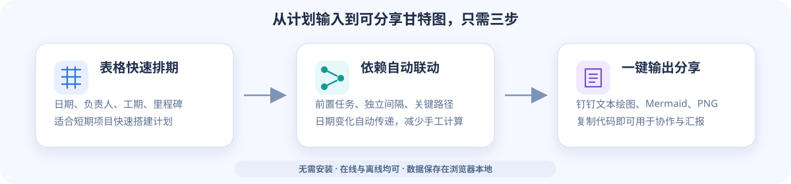
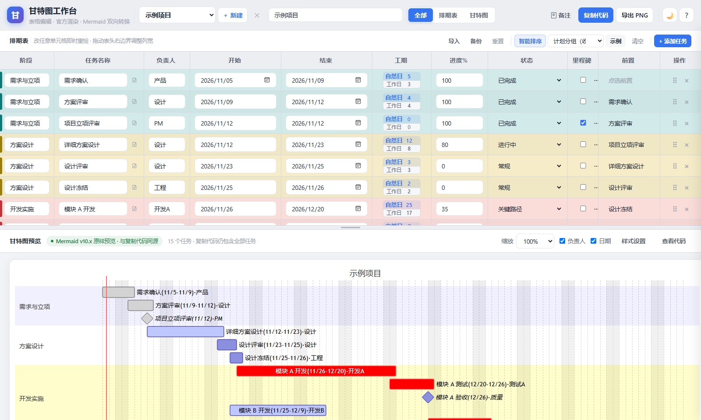
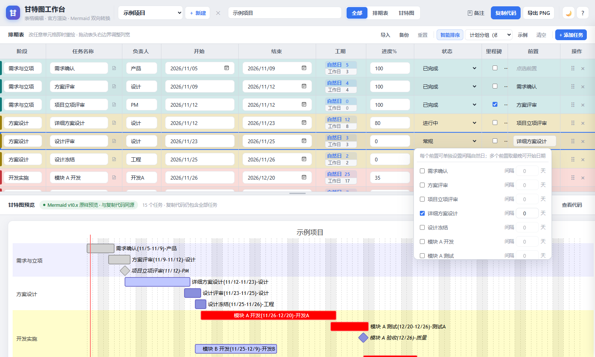
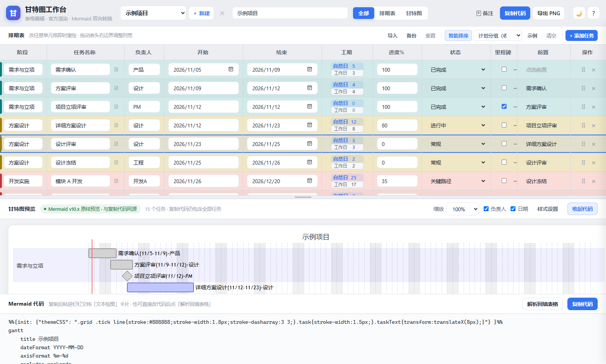

<div align="center">

# 甘特图工作台

**面向短期项目的轻量级排期工具：表格快速编辑、依赖与关键路径展示，并可一键生成钉钉文本绘图所需的 Mermaid 代码。**

[在线体验](https://lin-guang.github.io/Gantt_Plan/) · [下载 ZIP](https://github.com/Lin-guang/Gantt_Plan/archive/refs/heads/main.zip) · [完整使用说明](./完整使用说明.md)

</div>



## 为什么做这个工具

很多短期项目只需要快速排清任务、负责人、日期和前后依赖，使用大型项目管理软件反而增加学习与维护成本。

甘特图工作台把排期表与甘特图放在同一个页面中：修改表格后图表实时更新，完成后可直接复制 Mermaid 代码用于钉钉文本绘图，也可以导出 PNG 分享。

| 快速排期 | 依赖关系 | 直接分享 |
| --- | --- | --- |
| 像填写表格一样安排阶段、任务、负责人和日期 | 支持前置任务、独立间隔、里程碑及关键路径标记 | 一键复制 Mermaid 代码，适配钉钉文本绘图，也可导出 PNG |

## 功能效果

### 1. 排期表与甘特图实时联动

在表格中修改任务、负责人、日期、工期、进度或状态，下方甘特图会同步更新。适合快速搭建几周到几个月的项目计划。



### 2. 前置依赖与关键路径

每个任务可以设置一个或多个前置任务，并为每个前置单独设置间隔自然日。日期变化会沿依赖关系自动联动，也可以通过状态突出关键路径。



### 3. Mermaid 双向转换与钉钉输出

排期完成后可直接复制 Mermaid 代码，粘贴到钉钉文档的文本绘图卡片中；已有 Mermaid 甘特图代码也可以解析回表格继续编辑。



## 核心优势

- **简单直接**：不需要学习专业项目管理软件，打开网页即可填写。
- **在线与离线均可**：可以使用在线链接，也可以下载后双击 `打开甘特图.html`。
- **排期双向联动**：日期、工期、前置任务和里程碑约束自动同步，减少重复计算。
- **适合短期项目**：聚焦任务排布、依赖检查、进度展示和阶段汇报。
- **方便协作分享**：支持钉钉文本绘图、Mermaid 代码和 PNG 图片。
- **数据留在本地**：项目数据默认保存在当前浏览器，不需要账号或数据库。

## 主要功能

- 多项目新建、切换和复制
- 阶段、任务、负责人、起止日期和进度编辑
- 自然日 / 工作日工期反向修改
- 多前置任务与独立间隔时间
- 里程碑日期约束与关键路径状态
- 计划分组、颜色标识和分组筛选
- 任务备注与待办清单导出
- Mermaid 代码导入、解析、复制和回填
- 甘特图缩放、样式设置和 PNG 导出
- 本地备份、恢复与跨设备迁移

## 快速开始

### 在线使用

打开：**[https://lin-guang.github.io/Gantt_Plan/](https://lin-guang.github.io/Gantt_Plan/)**

### 下载使用

1. [下载 ZIP](https://github.com/Lin-guang/Gantt_Plan/archive/refs/heads/main.zip)。
2. 解压整个文件夹。
3. 双击 **`打开甘特图.html`**。

不需要安装软件或运行命令。下载后请保留整个文件夹，不要只复制一个 HTML 文件。

## 适合场景

- 新产品、定制项目或专项任务的短期排期
- 多部门任务交接与依赖关系确认
- 里程碑、关键节点和关键路径展示
- 周会、项目汇报和计划变更同步
- 需要在钉钉文档中持续维护甘特图的团队

## 数据保存说明

排期数据保存在当前浏览器的本地存储中，不会自动上传服务器，也不会自动同步到其他设备。重要项目请定期使用页面中的 **“备份”** 功能导出备份文件。

在线版和下载版使用不同地址时，本地数据彼此独立，可通过备份文件迁移。

详细按钮与字段说明请查看 **[完整使用说明](./完整使用说明.md)**。

<details>
<summary>开发与测试</summary>

```bash
npm install
npm test
```

主要文件：

- `index.html`：应用主体
- `mermaid.min.js`：Mermaid 浏览器运行文件
- `smoke-test.js`：核心逻辑测试
- `dom-e2e-test.js`：DOM 交互测试

</details>
